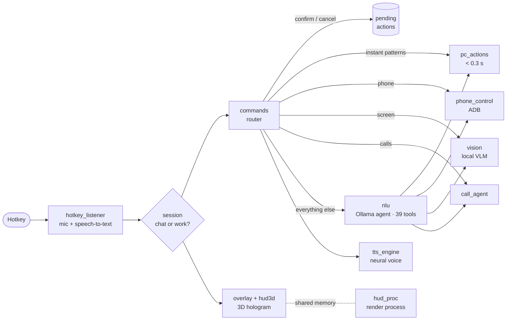

<div align="center">



<br>

[](https://github.com/dev-shubh-madara/hinata-x-jarvis/actions/workflows/tests.yml)


-111?logo=ollama&logoColor=white)

[](https://github.com/dev-shubh-madara/hinata-x-jarvis/stargazers)

### Press a hotkey. Say what you want. It's done. On your PC *and* your phone.

**Hinata** is a voice assistant in the spirit of JARVIS and FRIDAY. She runs on a **local AI**, so there's no API key, no cloud bill and no usage limit. She controls your Windows PC and your Android phone, looks at your screen, makes phone calls for you, and lives inside a real-time 3D hologram.

[**Quick start**](#-quick-start) · [**What she can do**](#-what-she-can-do) · [**Phone**](#-phone-control) · [**AI calls**](#-ai-phone-calls) · [**How it works**](#-how-it-works) · [**Config**](#%EF%B8%8F-configuration)

<br>


<sub><i>The hologram above was recorded from Hinata's own renderer. It's drawn live, frame by frame, with NumPy and Pillow, not a video.</i></sub>

</div>

---

## 📑 Contents

- [Why Hinata](#-why-hinata)
- [What she can do](#-what-she-can-do)
- [Quick start](#-quick-start)
- [Using Hinata](#%EF%B8%8F-using-hinata)
- [Phone control](#-phone-control)
- [AI phone calls](#-ai-phone-calls)
- [How it works](#-how-it-works)
- [Configuration](#%EF%B8%8F-configuration)
- [Safety](#%EF%B8%8F-safety-built-in)
- [Project structure](#%EF%B8%8F-project-structure)
- [Tests and CI](#-tests--ci)
- [Troubleshooting](#-troubleshooting)
- [FAQ](#-faq)
- [Roadmap](#%EF%B8%8F-roadmap)
- [Contributing](#-contributing) · [Credits](#-credits) · [License](#-license)

---

## 💡 Why Hinata

| | Hinata X Helper | Typical cloud assistant |
|---|---|---|
| **Brain** | Local LLM through Ollama, on your own GPU | A remote API |
| **Cost** | Free, no API key | Paid tokens or a subscription |
| **Privacy** | Commands and screenshots stay on your PC* | Sent to a server |
| **PC control** | 39 tools plus PowerShell, with multi-step chaining | Limited or none |
| **Phone control** | Full Android control over Wireless debugging | Usually none |
| **Looks** | Live 3D hologram HUD | A chat box |

<sub>*Speech-to-text (Google), the neural voice, weather and news use the internet. You can switch speech-to-text to offline Whisper.</sub>

---

## ✨ What she can do

<table>
<tr>
<td width="50%" valign="top">

### 🖥️ Your PC
- Open **any** app, file, folder or website (found automatically)
- Type, press shortcuts, snap, minimise and close windows
- Volume, brightness, media keys, Windows settings pages
- **Write** essays and code, and build styled **PowerPoints** with AI-written slides
- Screenshots, timers and spoken reminders
- File actions (deletes go to the Recycle Bin, after you confirm)
- **PowerShell** for anything else, with a safety gate

</td>
<td width="50%" valign="top">

### 📱 Your phone
- Pair once with a **6-digit code** (or a QR code)
- Open apps, **tap any button by its text**, type, swipe
- **Call** and **SMS** contacts by name (after you confirm)
- Wi-Fi, Bluetooth, data and brightness toggles, screenshots
- Read the screen aloud, plus screen mirroring through scrcpy
- **Order food** on Swiggy or Zomato, with a payment lock
- Run any Android shell command (risky ones are confirmed)

</td>
</tr>
<tr>
<td valign="top">

### 🧠 FRIDAY-style powers
- **Screen vision:** *"What is this video about?"*, *"How do I export this?"*
- **AI phone calls:** she calls, talks, listens, hangs up and writes a transcript
- **Live info:** where the ISS is right now, news headlines, cricket scores
- **Conversation mode:** stays open while you chat, closes after real work
- Calls you **"Boss"** (you can change this)

</td>
<td valign="top">

### ⚡ Fast and smooth
- Common commands skip the AI and run in **under 0.3 s**
- Model preloaded and kept warm, with an app and file index built at startup
- The hologram renders in **its own process**, so the window never stutters
- **Adaptive resolution** that holds your target FPS
- **Barge-in:** press the hotkey while she's talking and she stops to listen

</td>
</tr>
</table>

---

## 🚀 Quick start

> **You need:** Windows 10 or 11, [Python 3.10+](https://python.org) (tick *"Add to PATH"*) and [Ollama](https://ollama.com).

```bash
# 1. get the code
git clone https://github.com/dev-shubh-madara/hinata-x-jarvis.git
cd hinata-x-jarvis

# 2. the local AI brain (pick one)
ollama pull qwen2.5:3b        # fast, works on most PCs
ollama pull qwen2.5:7b        # smarter, needs a 6 GB+ GPU

# 3. install and run
setup_and_run.bat             # installs everything, then starts Hinata
```

After the first run, just use `run.bat`, or run `py -3 main.py` from the terminal.

<details>
<summary><b>Manual install / PyAudio problems</b></summary>

```bash
py -3 -m pip install -r requirements.txt
py -3 main.py
```
If PyAudio won't install: `pip install pipwin && pipwin install pyaudio`.
If the hotkeys don't respond, run the terminal **as administrator**. The `keyboard` library needs it on some PCs.
</details>

### 🔁 Start with Windows

Double-click **`install_autostart.bat`** once. From then on, Hinata starts by herself about 15 seconds after you log in, with no black window. Just press <kbd>Ctrl</kbd>+<kbd>Shift</kbd>+<kbd>H</kbd>.
Run `uninstall_autostart.bat` to turn it off. Only one Hinata can run at a time, so starting her by hand while she's already running does nothing.

---

## 🎙️ Using Hinata

| Hotkey | Action |
|---|---|
| <kbd>Ctrl</kbd> + <kbd>Shift</kbd> + <kbd>H</kbd> | **Speak** a command |
| <kbd>Ctrl</kbd> + <kbd>Shift</kbd> + <kbd>J</kbd> | **Type** a command (quiet room, or the fastest option) |
| Right-click the **hologram** | Sends it back to the small orb (she keeps running) |
| Right-click the **orb** | Menu: talk, type, or quit |

**Speak naturally.** She waits about **1.5 seconds of silence** before acting. If she cuts you off, raise `END_OF_SPEECH_PAUSE` in `config.py`.

### Things to say

| You say | What happens |
|---|---|
| "open VS Code" · "open resume.pdf" · "open downloads" | Opens it (apps and files are found automatically) |
| "play Believer by Imagine Dragons" | Plays it on YouTube |
| "volume 30" · "brightness 70" · "mute" | Sets it instantly |
| "open notepad and write a poem about rain" | Multi-step: opens Notepad, writes, types |
| "make a presentation about black holes" | Builds a styled `.pptx` with AI-written slides |
| "remind me in 10 minutes to drink water" | Spoken reminder plus a toast |
| "how's my laptop doing?" | CPU, RAM, disk and the heaviest apps |
| "what's my IP address?" | She writes and runs the PowerShell for it |
| **"what is this video about?"** | Looks at your screen and answers |
| **"where is the ISS right now?"** | Live position, plus the live map |
| "latest news" · "news about ISRO" · "cricket score" | Live headlines and scores |
| **"pair to phone"** | Connects your Android phone |
| "on my phone open WhatsApp, tap Vishal, type hi" | Does it on the phone |
| **"order chicken biryani on Swiggy"** | Gets to the cart and asks before paying |
| **"call mom and tell her I'll be late today"** | Makes the call and does the talking |
| "shut down" → **"confirm"** | Power actions always ask first |

### 💬 Conversation mode
- **Chatting** (questions, chit-chat, the time, the weather): the hologram **stays open** and keeps listening, with no hotkey between sentences.
- **Real work** (open, make, play, pair, type…): she does it, answers in a few words, and the hologram **closes** so you can see the result.
- **Close it any time:** say *"close"*, *"bas karo"*, *"that's all"* or *"okay Hinata, let's continue with our work"*. She also closes after 30 seconds of silence.

---

## 📱 Phone control

### Hinata Link (default, no wireless-debugging pairing needed)

Some laptops can't finish Android's wireless-debugging pairing. Mine kept failing with `protocol fault` because of the firewall. Hinata Link avoids that completely: the phone gives itself ADB rights through **Shizuku**, and a tiny helper in **Termux** takes Hinata's commands over the local network. Every request is signed with a secret key from the setup QR.

**One-time setup:**
1. Install **Shizuku** (Play Store) and **Termux** (F-Droid or GitHub, not the old Play Store build).
2. In Shizuku, tap **Start via Wireless debugging**. It pairs the phone with *itself*, so no PC is involved.
3. In Shizuku, open **Use Shizuku in terminal apps → Export files** and pick `Documents/sh`.
4. Say **"pair to phone"** to Hinata. Scan the QR with your camera, copy the text, paste it into Termux and press Enter.
5. Tap **Allow** when Termux or Shizuku ask. Hinata connects on her own.

On college or open Wi-Fi, Hinata first turns on the laptop hotspot and shows a Wi-Fi QR for the phone.
**After a phone restart:** open Shizuku → **Start**, then open Termux. Say *"connect my phone"* if she doesn't pick it up herself.

### Classic ADB pairing

Set `PAIR_METHOD = "code"` (6-digit pairing code) or `"qr"` in `config.py` to use Android's own wireless-debugging pairing instead.

<details>
<summary><b>Phone settings for the classic method</b></summary>

1. **Settings → About phone →** tap **Build number** 7 times (this turns on Developer options).
2. **Developer options →** turn on **Wireless debugging**.
3. *Realme, Oppo or Xiaomi:* also turn on **Disable permission monitoring** or **USB debugging (Security settings)**.
4. Say **"pair to phone"**, then on the phone open **Wireless debugging → Pair device with pairing code**, and type the port and code into Hinata's form.
</details>

---

## 📞 AI phone calls

> *"Call mom and tell her I'll be late today."* → *"Confirm."*

Hinata dials from **your** phone, then says: *"Hello Mom, I'm Hinata, Shubh's AI assistant. Shubh is a bit busy, so he asked me to let you know that he will be late today."* She listens to the reply with speech recognition, answers with the local AI, says goodbye, hangs up, and **opens the transcript** (saved in `Desktop/Hinata_Output/Calls`).

| Mode | Setup | Quality |
|---|---|---|
| `CALL_AUDIO = "phonelink"` (default) | Windows **Phone Link** with Calls turned on (Bluetooth) | ⭐⭐⭐ clean |
| + VB-Audio Virtual Cable | Set **CABLE Output** as the *Default Communication Device* | ⭐⭐⭐⭐ studio-clean |
| `CALL_AUDIO = "speakerphone"` | Nothing. The phone goes on loudspeaker next to the laptop | ⭐⭐ works anywhere |

She **always says she's an AI assistant**, and only calls after you say "confirm". For Hindi calls, set `CALL_LANGUAGE = "hi-IN"`.

---

## 🧩 How it works



**The request pipeline, in order:**
1. Pending **confirm or cancel** (power, delete, calls, payments)
2. **Phone pairing** → `phone_pair` + `hotspot`
3. **AI calls** → `call_agent`
4. **Screen vision and live info** → `vision`, `live_info`
5. **Phone commands** → `phone_control`
6. **Instant patterns** (no AI, under 0.3 s) → `pc_actions`
7. **Local AI agent** → `nlu` (tool calling, multi-step, with a JSON fallback for models without tools)

More detail: [docs/ARCHITECTURE.md](docs/ARCHITECTURE.md).

---

## ⚙️ Configuration

Everything lives in **[`config.py`](config.py)**. The settings you're most likely to change:

| Setting | Default | What it does |
|---|---|---|
| `USER_NAME` / `USER_TITLE` | `"Shubh"` / `"Boss"` | Your name, and what she calls you |
| `HOTKEY` / `TYPE_HOTKEY` | `ctrl+shift+h` / `ctrl+shift+j` | Avoid Alt+Space, because Windows opens a window menu |
| `END_OF_SPEECH_PAUSE` | `1.5` | Seconds of silence before she acts |
| `FAST_MODEL` | `qwen2.5:3b` | Small, fast brain, downloaded once automatically (leaves GPU room for vision) |
| `NEURAL_VOICE` | `en-IN-NeerjaNeural` | Try `en-US-AriaNeural` or `hi-IN-SwaraNeural` |
| `STT_ENGINE` | `"google"` | `"whisper"` for offline speech on your GPU |
| `OLLAMA_MODEL` | `""` (auto) | Any model from `ollama list` |
| `VISION_MODEL` | `qwen2.5vl:3b` | Downloaded automatically the first time you ask |
| `CONVERSATION_MODE` | `True` | `False` closes after every command |
| `PAIR_METHOD` | `"link"` | `"code"` or `"qr"` for classic ADB pairing |
| `CALL_AUDIO` | `"phonelink"` | or `"speakerphone"` |
| `HUD_QUALITY` / `HUD_TARGET_FPS` | `auto` / `50` | `ultra` · `high` · `medium` · `low` |
| `AUTO_RUN_SAFE_COMMANDS` | `True` | `False` confirms **every** PowerShell command |

---

## 🛡️ Safety (built in)

- 🎧 She listens **only after you press the hotkey**. Nothing runs in the background.
- ✅ Shut down, restart, deletes (to the Recycle Bin), calls, SMS and any risky PowerShell **need a spoken "confirm"** within 25 seconds.
- 💳 **Payment lock:** buttons like *Pay* and *Place order* are detected on the phone screen and blocked until you say **"confirm"**. "Yes" is not enough. UPI PINs and lock-screen PINs are **never** typed.
- 📞 AI calls always introduce themselves as an **AI assistant**.
- 🧱 Risky Android shell commands (uninstall, wipe, reboot, `rm`…) are confirmed too.

---

## 🗂️ Project structure

```
hinata-x-jarvis/
├── main.py            # starts everything: log, HUD, warm-up, voice loop
├── config.py          # every setting
├── hotkey_listener.py # global hotkeys, mic, speech-to-text
├── session.py         # conversation mode (chat vs work)
├── commands.py        # the router: confirms, fast paths, phone, AI fallback
├── nlu.py             # local Ollama agent - 39 tools, multi-step
├── pc_actions.py      # everything on Windows + PowerShell safety gate
├── phone_control.py   # Android over ADB: tap by text, type, call, SMS, food, payment lock
├── phone_pair.py      # Hinata Link setup, pairing code / QR, auto-reconnect
├── link.py            # Hinata Link client (signed TCP to the phone helper)
├── phone/             # phone helper for Termux + Shizuku, one-line installer
├── hotspot.py         # Wi-Fi detection + Windows Mobile Hotspot
├── call_agent.py      # AI phone calls + transcripts
├── vision.py          # screenshot + local vision model
├── live_info.py       # ISS, news, cricket
├── overlay.py         # orb, full-screen HUD, captions, command bar, QR panel
├── hud3d.py           # real-time 3D hologram renderer (NumPy + Pillow)
├── hud_proc.py        # renderer process + shared-memory triple buffer
├── tts_engine.py      # neural voice, cache, barge-in
├── system_info.py     # app/file index, battery, stats, weather
├── web_answer.py      # keyless answers when the AI is offline
├── tests/             # headless test suite (fake PC, phone and AI)
└── docs/              # architecture, banner, hologram
```

---

## 🧪 Tests & CI

```bash
python tests/run_all.py
```

The tests run **headless, with a fake PC, phone and AI**, so they work on Linux or in CI without Windows or Ollama. They cover:

- **Commands:** the instant command patterns and conversation-mode end phrases
- **AI agent:** the multi-step agent loop with phone tools
- **Pairing:** pairing code, QR, the college Wi-Fi hotspot flow, mDNS being blocked, and retry after a `protocol fault`
- **AI calls:** a full scripted call conversation
- **New features:** screen-vision routing, call parsing, and the **payment lock**

GitHub Actions runs them on every push.

---

## 🧰 Troubleshooting

| Problem | Fix |
|---|---|
| "AI brain offline" | Open the Ollama app, then check with `ollama list` |
| Hotkey does nothing | Run the terminal as admin, or change `HOTKEY` |
| A menu pops up when you press the hotkey | Don't use Alt+Space-style hotkeys (Windows window menu). The default is Ctrl+Shift+H |
| She cuts you off mid-sentence | Raise `END_OF_SPEECH_PAUSE` to `2.5` or `3` |
| She hears nothing | Restart her in a quiet moment (she calibrates the mic at startup) |
| Phone: `protocol fault` while pairing | Your firewall (McAfee, Windows) is cutting adb. Allow `…\HinataXHelper\platform-tools\adb.exe` |
| Phone not found on college Wi-Fi | Let Hinata start the laptop hotspot and join it from the phone |
| Taps or typing on the phone do nothing | Realme, Oppo, Xiaomi: turn on *Disable permission monitoring* / *USB debugging (Security settings)* |
| Robotic voice | The neural voice needs internet; the robotic one is the offline fallback |
| Hologram is laggy | Plug in the charger and use the Performance power mode, pause any live wallpaper, or set `HUD_QUALITY = "medium"` |
| Screen vision is slow the first time | The vision model is loading into the GPU; later answers are faster |

---

## ❓ FAQ

<details><summary><b>Does it work without internet?</b></summary>
The AI brain, PC control and phone control all work offline. For speech, set <code>STT_ENGINE = "whisper"</code> (<code>pip install faster-whisper</code>). The voice falls back to the built-in Windows voice.
</details>

<details><summary><b>Which model should I use?</b></summary>
<code>qwen2.5:3b</code> for speed, <code>qwen2.5:7b</code> for smarts (6 GB+ GPU). Any model with tool calling works, and models without tools fall back to JSON actions.
</details>

<details><summary><b>Is my data sent anywhere?</b></summary>
Commands are understood by your local model. Screenshots for vision go to your local vision model. Only speech-to-text (Google, unless you use Whisper), the neural voice and live info use the internet.
</details>

<details><summary><b>Can she pay for things on her own?</b></summary>
No. She stops at any pay or place-order button and waits for you to say "confirm". UPI PINs are always yours to enter.
</details>

<details><summary><b>Linux or macOS?</b></summary>
PC control targets Windows today. The tests already run on Linux, and ports are welcome (see Contributing).
</details>

---

## 🗺️ Roadmap

- [ ] Wake word ("Hey Hinata") as an optional alternative to the hotkey
- [ ] Memory of preferences across sessions
- [ ] Plugin system for community tools
- [ ] Linux and macOS PC-control backends
- [ ] More HUD themes
- [ ] Hindi-first conversation mode

---

## 🤝 Contributing

PRs are welcome!
- **New tool:** add it to `nlu.py → TOOLS` and `commands.py → _execute`, then add a test in `tests/`.
- **New phone action:** `phone_control.py`
- **New HUD theme:** palettes in `hud3d.py`

Run `python tests/run_all.py` before you open a PR.

---

## 🙏 Credits

[Ollama](https://ollama.com) · [edge-tts](https://github.com/rany2/edge-tts) · [SpeechRecognition](https://github.com/Uberi/speech_recognition) · [Android platform-tools](https://developer.android.com/tools/releases/platform-tools) · [scrcpy](https://github.com/Genymobile/scrcpy) · [python-zeroconf](https://github.com/python-zeroconf/python-zeroconf) · [PyAudioWPatch](https://github.com/s0d3s/PyAudioWPatch) · NumPy · Pillow

---

## 📄 License

[MIT](LICENSE) © 2026 **Shubh** ([@dev-shubh-madara](https://github.com/dev-shubh-madara))

<div align="center">

**If Hinata helped you, please give the repo a ⭐. It really helps!**

<sub>Built with 💜 by Shubh · Madara</sub>

</div>
